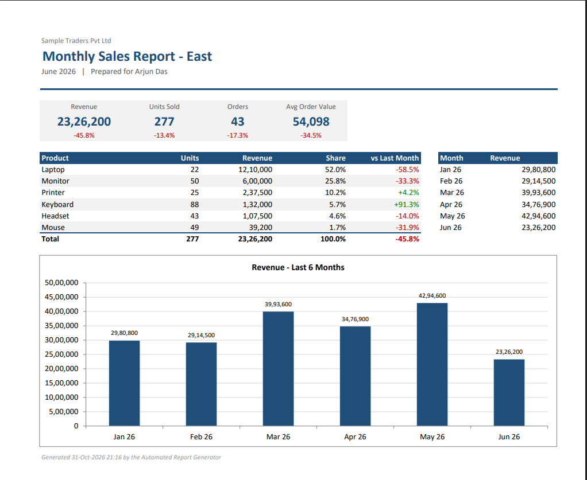

# Automated Report Generator (VBA)

Turn raw transaction data into polished monthly PDF reports, one per region, with KPIs, a product breakdown and a trend chart. Each report can also be saved as an Outlook draft ready to send.


---

## The Problem

Month-end reporting often looks like this: filter the data for each region, build a pivot, copy the numbers into a template, update a chart, save it as PDF, write an email, attach the file and repeat for every region.

Done by hand, this is **repetitive, slow and easy to get wrong**: a filter is left on, last month's chart isn't updated, or the wrong PDF goes to the wrong manager.

## The Solution

Set the month and click **Generate Reports**. For every region in the distribution list, the macro:

1. Calculates the KPIs and compares them with the previous month
2. Builds a formatted one-page report with a product table and a 6-month trend chart
3. Exports the report to PDF
4. Optionally saves an Outlook **draft** addressed to the region's manager, with the PDF attached and a KPI summary in the body
5. Records each region in a **Log** sheet

## Features

| Feature | Details |
|---|---|
| 📊 KPI summary | Revenue, units, orders and average order value, each with % change vs last month (green/red) |
| 📦 Product breakdown | Units, revenue, share of total and month-on-month change, sorted by revenue |
| 📈 Trend chart | Revenue over the last 6 months, with data labels |
| 📄 PDF export | One page per region, consistent layout, sensible file names |
| ✉️ Outlook drafts | Personalised email with the PDF attached, saved to Drafts and **never sent automatically** |
| ⚙️ Settings-driven | Month, company name, output folder and recipients are set on a sheet, with no code changes needed |
| ⚡ Fast | Data is read into memory once and aggregated in a single pass per region |
| 🔌 No setup | Outlook is late-bound, so no VBA library references need to be added |

## Sample Output



The sample workbook contains 1,436 transactions from January to June 2026 across four regions. Running it for **June 2026** produces:

```
Reports/
├── Sales Report - North - 2026-06.pdf
├── Sales Report - South - 2026-06.pdf
├── Sales Report - East - 2026-06.pdf
└── Sales Report - West - 2026-06.pdf
```

## How to Use

1. Download `ReportGenerator.xlsm` and open it (click **Enable Content** if prompted)
2. On the **Settings** sheet:
   - **Report Month:** any date in the month you want
   - **Company Name:** shown at the top of each report
   - **Output Folder:** leave blank to use a `Reports` folder next to the workbook
   - **Create Outlook Drafts:** `Yes` or `No`
   - **Distribution List:** region, manager, email and whether to include it
3. Paste your data into the **Data** sheet using the same columns
4. On the **Start** sheet, click **Generate Reports**

**Data layout expected:**

| Date | Region | Product | Category | Units | Unit Price | Revenue |
|---|---|---|---|---|---|---|

## Add It to Your Own Workbook

1. Press `Alt + F11`, then go to **File → Import File** and choose `src/modReportGenerator.bas`
2. Create the **Settings** and **Data** sheets in the same layout as the sample workbook, including the named ranges `ReportMonth`, `CompanyName`, `OutputFolder` and `CreateDrafts`
3. Run `GenerateReports`

## Project Structure

```
excel-report-generator/
├── ReportGenerator.xlsm        # ready-to-use workbook with sample data
├── src/
│   └── modReportGenerator.bas  # VBA source (readable on GitHub)
├── images/                     # screenshots for this README
├── README.md
└── LICENSE
```

## Roadmap

- [ ] Option to send directly instead of saving drafts
- [ ] Combined all-regions summary page
- [ ] Python version (pandas + matplotlib + reportlab), for comparison

---

**Author:** [Swaminathan Narayanan](https://www.linkedin.com/in/swaminathan-narayanan-9781a7154/): Data Analytics | Excel & VBA Automation | Python | SQL | Power BI
